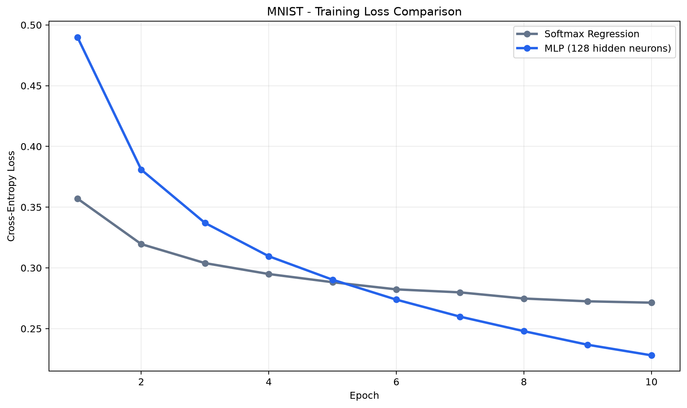

# MNIST Architecture Arena

A machine learning project exploring how neural network architecture affects handwritten digit classification, with models implemented entirely from scratch using **Python and NumPy**.

The project focuses on understanding the mathematical foundations of machine learning by manually implementing forward propagation, backpropagation, analytical gradients, and mini-batch optimization without relying on high-level machine learning frameworks.

Two architectures have been implemented and evaluated on the MNIST dataset:

- **Softmax Regression:** A linear multiclass classifier serving as the baseline.
- **Multilayer Perceptron (MLP):** A fully connected neural network with one hidden layer and ReLU activation.

The project also includes reproducible experiments, automated metric logging, numerical gradient checking, and training loss visualization.

---

## 1. Experimental Results

Both models were trained using 55,000 MNIST images and evaluated on the same independent validation set of 5,000 images.

### Model Performance

| Model | Architecture | Validation Accuracy | Validation Loss | Final Training Loss |
|---|---|---:|---:|---:|
| Softmax Regression | 784 → 10 | 90.92% | 0.3155 | 0.2714 |
| MLP (ReLU) | 784 → 128 → 10 | **92.50%** | **0.2528** | **0.2280** |

The MLP achieved an improvement of **1.58 percentage points** in validation accuracy, correctly classifying 79 additional images compared with Softmax Regression.

It also achieved a lower validation cross-entropy loss, indicating improved predictive performance beyond classification accuracy alone.

Both models were trained for 10 epochs with a batch size of 64. However, different learning rates were used, so the improvement cannot be attributed exclusively to architecture.

### Training Loss Comparison



The training curves reveal several observations:

- Softmax Regression initially achieves a lower training loss.
- The MLP's training loss decreases more substantially over successive epochs.
- After approximately six epochs, the MLP achieves a lower training loss than Softmax Regression.
- Both models exhibit stable optimization throughout training.

The MLP's nonlinear hidden layer provides greater representational capacity than the linear baseline, although additional controlled experiments are needed to isolate the impact of architecture.

**Important:** All reported accuracy results refer to the validation set. The independent test set remains reserved for final model evaluation.

---

## 2. Model Architectures

### 2.1 Softmax Regression

Softmax Regression extends binary logistic regression to multiclass classification.

For an input matrix `X`, the model first computes the logits:

```text
Z = X @ W + b
```

The logits are converted into class probabilities using Softmax:

```text
P[i,j] = exp(Z[i,j]) / sum(exp(Z[i,k]) for k in classes)
```

The model minimizes mean categorical cross-entropy:

```text
L = -(1/m) * sum(Y[i,j] * log(P[i,j]) for all samples i and classes j)
```

where:

- `m` is the number of training samples.
- `Y` contains the one-hot encoded target labels.
- `P` contains the predicted class probabilities.

The analytical gradients are:

**Weight gradient:**

```text
dW = X.T @ (P - Y) / m
```

**Bias gradient:**

```text
db = sum(P - Y, axis=0) / m
```

These gradients are implemented using vectorized NumPy operations.

**Implementation features:**

- Numerically stable Softmax
- Categorical cross-entropy loss
- Analytical gradient computation
- Vectorized matrix operations
- Mini-batch gradient descent
- Epoch-wise training loss tracking

### 2.2 Multilayer Perceptron

The MLP introduces a nonlinear hidden layer to learn more complex relationships between input pixels and output classes.

**Architecture:**

```text
Input Layer
784 features
    |
    v
Fully Connected Layer
128 neurons
    |
    v
ReLU Activation
    |
    v
Fully Connected Layer
10 neurons
    |
    v
Softmax
    |
    v
Class Probabilities
```

#### Forward Propagation

First hidden layer:

```text
Z1 = X @ W1 + b1

A1 = ReLU(Z1)
```

Output layer:

```text
Z2 = A1 @ W2 + b2

P = Softmax(Z2)
```

The ReLU activation is defined as:

```text
ReLU(x) = max(0, x)
```

Unlike Softmax Regression, the MLP can learn nonlinear decision boundaries.

#### Backpropagation

The gradients are calculated manually using the chain rule.

**Output-layer error:**

```text
dZ2 = P - Y
```

**Output-layer gradients:**

```text
dW2 = A1.T @ dZ2 / m

db2 = sum(dZ2, axis=0) / m
```

**Hidden-layer error:**

```text
dZ1 = (dZ2 @ W2.T) * (Z1 > 0)
```

Here, `*` represents element-wise multiplication. The boolean expression `(Z1 > 0)` implements the derivative of ReLU, taking the derivative at zero to be zero.

**Hidden-layer gradients:**

```text
dW1 = X.T @ dZ1 / m

db1 = sum(dZ1, axis=0) / m
```

All gradients are computed using vectorized NumPy operations without automatic differentiation.

**Implementation features:**

- He weight initialization
- ReLU activation
- Manual backpropagation
- Analytical gradient computation
- Numerical gradient checking
- Mini-batch gradient descent
- Reproducible parameter initialization

---

## 3. Dataset and Preprocessing

The project uses the MNIST handwritten digit dataset.

MNIST contains 70,000 grayscale images representing digits from 0 to 9.

Each image has a resolution of 28 × 28 pixels.

### Dataset Split

| Dataset | Samples | Purpose |
|---|---:|---|
| Training | 55,000 | Parameter optimization |
| Validation | 5,000 | Model evaluation and comparison |
| Test | 10,000 | Final evaluation |

### Preprocessing

The preprocessing pipeline performs the following operations:

1. Downloads MNIST automatically if it is not already available.
2. Flattens each 28 × 28 image into a 784-dimensional vector.
3. Normalizes pixel intensities from `[0, 255]` to `[0, 1]`.
4. Creates a reproducible training-validation split using a fixed random seed.
5. Converts class labels into one-hot encoded vectors.

The independent test set is not used during model development.

---

## 4. Training Methodology

Both architectures are trained using mini-batch gradient descent.

For every epoch:

1. Shuffle the training data.
2. Divide the dataset into mini-batches.
3. Perform forward propagation.
4. Compute gradients using analytical differentiation.
5. Update model parameters.
6. Calculate the training loss over the complete training dataset.
7. Record the loss for experiment tracking.

Parameter updates follow:

```text
theta_new = theta_old - learning_rate * gradient
```

where:

- `theta` represents model parameters.
- `learning_rate` is the optimization step size.
- `gradient` is the derivative of the loss with respect to the parameter.

### Training Configurations

| Hyperparameter | Softmax Regression | MLP |
|---|---:|---:|
| Input dimensions | 784 | 784 |
| Hidden neurons | — | 128 |
| Output classes | 10 | 10 |
| Epochs | 10 | 10 |
| Batch size | 64 | 64 |
| Learning rate | 0.1 | 0.01 |
| Random seed | 42 | 42 |
| Optimizer | Mini-batch SGD | Mini-batch SGD |
| Loss function | Cross-Entropy | Cross-Entropy |

These settings establish the initial experimental baseline for further architectural comparisons.

---

## 5. Experiment Tracking

A reusable experiment tracking utility stores model configurations, performance metrics, training histories, and visualizations.

Each experiment is saved in its own directory.

```text
experiments/
├── softmax_baseline/
│   ├── config.json
│   ├── metrics.json
│   ├── history.json
│   └── training_loss.png
│
├── mlp_128/
│   ├── config.json
│   ├── metrics.json
│   ├── history.json
│   └── training_loss.png
│
└── comparison/
    └── training_loss.png
```

### Experiment Files

| File | Description |
|---|---|
| `config.json` | Model architecture and training hyperparameters |
| `metrics.json` | Training and validation performance metrics |
| `history.json` | Epoch-wise training loss |
| `training_loss.png` | Training loss visualization |

This structure supports reproducibility, comparison, and systematic experimentation.

---

## 6. Testing and Numerical Verification

The project uses pytest for automated testing.

Tests cover:

**Softmax and Cross-Entropy**

- Probability normalization
- Output shape preservation
- Numerical stability
- Softmax invariance under constant shifts
- Known cross-entropy values
- Mathematical properties of the loss function

**Multilayer Perceptron**

- ReLU activation properties
- Parameter shape verification
- Forward propagation behavior
- Numerical gradient checking

### Numerical Gradient Checking

To verify backpropagation, analytical gradients are compared against numerical approximations obtained using finite differences.

For a parameter `theta`:

```text
numerical_gradient =
    (Loss(theta + epsilon) - Loss(theta - epsilon)) / (2 * epsilon)
```

This provides an independent check of the manually derived gradients.

Run the test suite with:

```bash
python -m pytest -v
```

---

## 7. Project Structure

```text
mnist-architecture-arena/
│
├── models/
│   ├── softmax_regression.py
│   └── mlp.py
│
├── utils/
│   ├── data.py
│   ├── experiments.py
│   └── plots.py
│
├── tests/
│   ├── test_softmax.py
│   └── test_mlp.py
│
├── experiments/
│   ├── softmax_baseline/
│   ├── mlp_128/
│   └── comparison/
│
├── run.py
├── requirements.txt
├── pytest.ini
├── .gitignore
└── README.md
```

---

## 8. Installation and Usage

### Clone the Repository

```bash
git clone https://github.com/ArdaDemirbilek/mnist-architecture-arena.git

cd mnist-architecture-arena
```

### Create a Virtual Environment

```bash
python -m venv .venv
```

Activate the environment.

**Windows PowerShell:**

```powershell
.\.venv\Scripts\Activate.ps1
```

**Linux/macOS:**

```bash
source .venv/bin/activate
```

### Install Dependencies

```bash
python -m pip install -r requirements.txt
```

### Run the Experiments

```bash
python run.py
```

This command:

1. Loads and preprocesses MNIST.
2. Trains Softmax Regression.
3. Trains the MLP.
4. Evaluates both models on the validation set.
5. Saves experimental configurations and metrics.
6. Generates individual training loss visualizations.
7. Displays a performance comparison in the terminal.

The comparison figure can also be generated from previously saved training histories using the plotting utility.

### Run Tests

```bash
python -m pytest -v
```

---

## 9. Roadmap

### Completed

- [x] Implement numerically stable Softmax
- [x] Implement categorical cross-entropy
- [x] Implement Softmax Regression from scratch
- [x] Derive and implement analytical gradients
- [x] Implement mini-batch gradient descent
- [x] Build reproducible MNIST preprocessing pipeline
- [x] Implement MLP with ReLU activation
- [x] Implement manual backpropagation
- [x] Add numerical gradient checking
- [x] Train and evaluate both architectures
- [x] Implement experiment tracking
- [x] Visualize and compare training loss curves

### Planned Improvements

**Architecture Experiments**

- [ ] Compare different hidden-layer widths
- [ ] Investigate deeper MLP architectures
- [ ] Explore convolutional neural networks

**Optimization and Generalization**

- [ ] Investigate learning-rate sensitivity
- [ ] Implement L2 regularization
- [ ] Experiment with early stopping
- [ ] Compare training and validation loss curves

**Evaluation and Error Analysis**

- [ ] Generate confusion matrices
- [ ] Analyze commonly misclassified digits
- [ ] Visualize incorrect predictions
- [ ] Evaluate the selected model on the held-out test set

---

## 10. Technologies

- Python
- NumPy
- Matplotlib
- pytest

All neural network architectures, gradient calculations, and optimization procedures are implemented manually using NumPy.

No high-level deep learning framework is used for model training.

---

## Author

**Arda Demirbilek**

B.Sc. Computer Engineering  
RWTH Aachen University

[GitHub](https://github.com/ArdaDemirbilek)